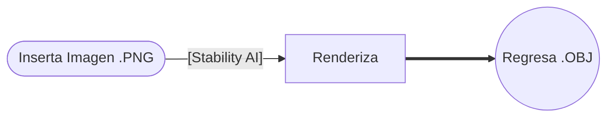

# in1050-A2-Muebles3D

### Stability / stable-fast-3d:
**Diseño de interiores**; a base de una fotografía transformar la imagen *.png* de un mueble a un formato *.obj*, es decir en 3D.
Este proyecto apoya a los diseñadores de interiores al momento de presentar un proyecto, se puede visualizar en realidad aumentada, brindando una mayor profesionalidad al proyecto.

| Integrante | Rol |
|:---|:---|
| Carlos Eduardo Lozano Delgadillo | Crear Repositorio/Ayudar Investigación |
| Jonathan Gael Arteaga Martínez | Investigación del Modelo / Cálculo de VRAM necesaria|
| Oscar Iván Cruz Villa | Correr el modelo en Spaces / Ayudar Investigación|
| Jorge Santiago Juárez Oliva | Investigación |

### Problemática:
Diseñadores de interiores; presentación actual de proyectos simple; [Documentación](docs/investigación.md)

### Caso de uso:
El usuario enfocado al objetivo de nuestro proyecto; Diseñador de Interiores, brinda una imagen ,png del mueble y el modelo regresa esa imagen en .obj.
Es decir en 3D.

### Modelo
| Dato                         | Respuesta                                                                                                                                                                                                            |
| ---------------------------- | -------------------------------------------------------------------------------------------------------------------------------------------------------------------------------------------------------------------- |
| Identificador                | [Stabilityai / stable-fast-3d](https://huggingface.co/stabilityai/stable-fast-3d)                                                  |
| Tarea                        | Este modelo esta entrenado para generar un  plano 3D desde una imagen.                                                                                                                                               |
| Número de parámetros         | FP32 / 1B                                                                                                                                                                                                            |
| Licencia                     | stabilityai-ai-community                                                                                                                                                                                             |
| Limitación o sesgo declarado | El modelo no fue entrenado para ser representaciones fácticas o verdaderas de personas o eventos. Como tal, el uso del modelo para generar dicho contenido está fuera del alcance de las capacidades de este modelo. |

### Cómo Funciona

### Infraestructura

$$
\text{Memoria mínima} = 1,000,000,000 \times 4\ \text{bytes} \approx \ 4\text{GB}
$$
El modelo correra en la misma **CPU**, ya que no cuenta con modelo adaptado en Google Collab por lo que se descargara y se correrá con el hardware local, ya que el modelo no necesita mucha memoria **VRAM**.

### Riesgo Ético
- **Riesgo**: Pueden llegar a subir imágenes de personas y convertirlas a 3D **.OBJ** sin consentimiento alguno.
- **Mitigación:** Con ayuda del profesor, adaptar el código para que identifique rasgos faciales y no realicé un modelado de la persona.

### Cambios respecto a la Fase 1:
Durante el primer parcial nos comentaron la necesidad de correr el modelo en local, sin embargo por distintas complicaciones no fue posible, el profesor nos comentó que en el próximo parcial, veremos como correrlo en local y adaptarlo a GitHub, en sí mismo el modelo fue utilizado en Spaces dentro de Hugging Face, por lo que conocemos cómo funciona, solamente es correrlo en local.

### Siguientes pasos:
- [ ] Correr el modelo en Local
- [ ] Investigación de la Problemática
- [ ] Adaptarlo a GitHub
- [ ] Encontrar errores e intentar mitigarlos (Duplicación de Rostros)

### Referencias:
- [Stabilityai / stable-fast-3d](https://huggingface.co/stabilityai/stable-fast-3d)

