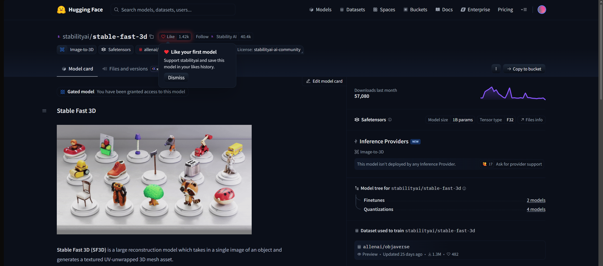
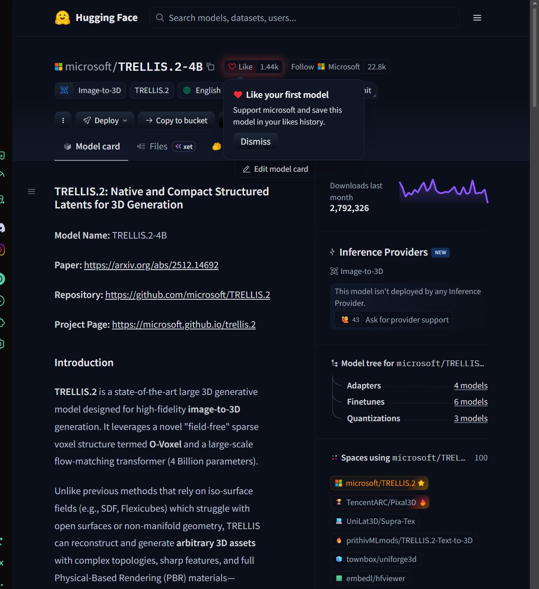

# Investigación de la Problemática
## 1. El problema

El problema principal de el modelaje 3D para interiores es el tiempo, es un proceso demasiado tardado, llegando a tardar hasta 3 o 6 horas por mueble según estadísticas de [Homestyler](https://es.homestyler.com/article/trends/how-long-does-d-modeling-take-understanding-timeframes-for-i).

Diversos análisis de eficiencia en firmas de arquitectura (como Business Research Insights y reportes de la industria CAD) destacan que la fase de modelado y preparación consume hasta un 30%-40% del tiempo total dedicado al diseño de un proyecto de interiores.

Nuestro publico preferente son los arquitectos y esta **Inteligencia Artificial** busca resolver y optimizar todo este tiempo perdido, para que con una simple fotografía puedan modelar dichos muebles

## 2. Cómo se resuelve hoy

|Alternativas|¿Que ofrece?|Limitaciones|
|:-----------|:-----------|:-----------|
|Aplicaciones de paga|Una buena renderización y modelado, mejor mantenimiento|El costo es excesivo, desde $1000 dólares la suscripcion|
|Modelado Manual|Tu tienes el control de todo, el modelo lo haces desde 0|Muy poca optimizacion, el tiempo que tardas en modelar aumenta drasticamente|
|otras IA's|Modelado rápido de muebles|A veces no entrega el resultado deseado y tienes un numero limitado de tokens|

## 3. Por qué con IA y por qué este modelo

El *modelo fue seleccionado* debido a que, el realizar un modelado, en blender por ejemplo de algún mueble o algo en específico, requiere de tiempo y esfuerzo innecesario, que con **Stabilityai/stable-fast-3D** puede realizar en poco tiempo.

Sin embargo, nuestro modelo no es el único, por ejemplo en **Hugging Face** teníamos varias opciones, por ejemplo:

- ***TRELLIS.2-4B***: El cual es un modelo de Microsoft, sin embargo no escogímos este modelo debido a que es demasiado pesado para correr en Google Collab, o en alguna computadora con gráfica.

A continuación presentamos una tabla comparativa entre los dos modelos.
### Stabilityai/stable-fast-3D

| **Dato** | **Respuesta** |
|:--- | --- |                           
| Identificador |[Stabilityai/stable-fast-3d](https://huggingface.co/stabilityai/stable-fast-3d) |
| Tarea | Este modelo está entrenado para generar un plano 3D desde una Imagen |
| Número de parámetros | FP32 /1B|
| Licencia |stabilityai-ai-community |
| Limitación (Model Card) |El modelo no fue entrenado para hacer representaciones fácticas o verdaderas de personas o eventos. Como tal. el uso del modelo para generar dicho contenido está fuera del alcance de las capacidades de este modelo. |

### TRELLIS.2-4B
|**Dato**|**Respuesta**|
|---|---|
|Identificador| [TRELLIS.2-4B](https://huggingface.co/microsoft/TRELLIS.2-4B)|
|Tarea| Generador de alta fidelidad de **imagen-3D** |
|Número de Parámetros| ***4B FP32***; aunque marca que en necesidad de hardware necesita una NVIDIA GPU con un mínimo de **24GB de VRAM**|
|Licencia| Este modelo es lanzado desde la licencia del MIT; el código y la base de datos son compartidas publicamente para facilitar su reproducción e investigación futura.|
|Limitación (Model Card)|- **Problemas geométricos (pequeños agujeros):** Aunque O-Voxels maneja topologías complejas, las mallas generadas pueden presentar pequeños agujeros o discontinuidades. Para solucionarlo, se proporcionan herramientas de posprocesamiento que permiten rellenarlos y obtener modelos adecuados para impresión 3D.                                                                                                             **- Modelo base sin alineación:** TRELLIS.2-4B es un modelo preentrenado que no ha sido ajustado mediante preferencias humanas ni optimizado para estilos estéticos específicos. Por ello, los resultados pueden variar según los datos de entrenamiento y es posible que se necesiten varios intentos para conseguir el resultado deseado.|

Finalmente se eligió el modelo Stability, debido a que necesitaba menos parámetros por lo que es mucho más flexible su uso en dispositivos con menor capacidad de renderizado.

## 4. Usuarios y Requisitos

### Usuarios del sistema
1. **Diseñadores de interiores / Arquitectos:** Usuarios expertos que cargan imágenes de planos o espacios 2D para que el modelo IA genere el objeto/espacio en 3D de forma rápida, reduciendo tiempos de modelado manual.
2. **Clientes / Propietarios:** Usuarios finales que visualizan los planos 3D generados a partir de sus imágenes para revisar distribuciones y validar la propuesta visual.
3. **Administradores del sistema:** Personal técnico que gestiona la API del modelo [Stabilityai/stable-fast-3d](https://huggingface.co/stabilityai/stable-fast-3d), ajusta parámetros (FP32 / 1B) y supervisa el cumplimiento de la licencia y límites de uso.

### Requisitos del sistema

#### Requisitos Funcionales 
1. **Conversión 2D a 3D por IA:** El sistema debe integrar el modelo [Stabilityai/stable-fast-3d](https://huggingface.co/stabilityai/stable-fast-3d)` para procesar una imagen de entrada y generar un plano o volumen en 3D automáticamente.

2. **Carga de imágenes:** El sistema debe permitir al usuario subir archivos de imagen (JPG, PNG) de planos o borradores 2D para ser procesados.

3. **Visualización y exportación 3D:** El sistema debe permitir previsualizar e interactuar con el modelo 3D resultante generado por la IA.

4. **Restricción de contenido no permitido:** El sistema debe aplicar filtros para validar que las imágenes subidas correspondan a planos o espacios de diseño de interiores, respetando las limitaciones del modelo sobre personas o eventos reales.

#### Requisitos No Funcionales 
 1. **Precisión y capacidad del modelo:** El sistema debe operar con la configuración del modelo a 1B de parámetros (FP32) para mantener el equilibrio entre velocidad de inferencia y calidad tridimensional.

2.  **Tiempo de generación:** El modelo debe procesar la imagen y retornar la estructura 3D en pocos segundos (generación rápida).

3. **Licencia y cumplimiento:** El uso y distribución de la funcionalidad dentro de la plataforma debe estar alineado con los términos de la licencia *Comunidad StabilityAI-AI*.

4. **Delimitación del alcance (Tarjeta de Modelo):** El sistema no debe utilizarse para intentar reconstruir representaciones fácticas de personas o eventos en vivo, manteniéndose exclusivamente dentro del alcance de espacios arquitectónicos y de diseño.
  
## 5. Impacto Ético

### Privacidad de los datos: 

El modelo Stable Fast 3D recibe una imagen de un objeto, la procesa para generar un modelo en 3D, el riesgo se encuentra no en lo que generé el modelo, sino en las imágenes que puedan llegar a proporcionar los usuarios.
Ejemplo:
- Fotografía de algún objeto que podría contener accidentalmente información personal, de documentos o elementos privados

Algunas medidas que se pueden aplicar para proteger la privacidad, pueden ser por parte del usuario; como evitar tomar fotografías con documentos personales, rostros o información confidencial

Sin embargo dentro del proyecto se pretende correr el modelo en Local, por lo cual, no se estarían mandando las imágenes a un servidor, si no que se correrían totalmente dentro de la computadora personal del usuario.

### Sesgos que podría heredar el modelo:

El modelo funciona a base de una fuente de datos llamada **Objaverse**, el cual contiene cientos de miles de objetos tridimensionales, sin embargo esto no significa que el modelo no presente sesgos:

#### Posibles Sesgos:
|** Sesgo **| **Situación** | **¿A quién perjudicaria?** |
|----|-----|-----|
| **Sesgo Cultural** |El modelo podría construir mejor los objetos comunes queobjetos artesanales o no tan comúnes que pertenezcan a cierta cultura.|Artesanos, diseñadores, público en general (dependiendo del proyecto)|
| **Sesgo de Representación** | Objetos poco frecuentes puede llevar a reconstrucciones menos precisas.| Diseñadores que trabajen con objetos muy específicos.|
| **Sesgo de Materiales** | Podría interpretar los materiales transparentes o reflectantes por lo que puede llevar a una mala construcción del modelo | Diseladores de interiores|
|**Sesgo de Iluminación**| Fotografías con sombras, reflejos, o condiciones de iluminación que puedan llegar a producir resultados incorrectos | Cualquier persona que no cuente con un espacio adecuado para tomar la foto.|

El problema de estos sesgos recae; en que el modelo realiza el objeto en 3D a base de una sola imagen, por lo que puede generar partes, o completar partes sin suficientes datos, por lo que no corresponderían al objeto original.

### ¿Quién responde si el modelo se equivoca?
En el caso de este proyecto los responsables seríamos nosotros como desarrolladores, lo que se está (pretendiendo) lanzando al mercado debería de ser seguro y probado cientos de veces antes de publicarse.

En caso de que el modelo se utilice, de manera independiente, sin que sea parte de nuestro proyecto, la responsabilidad caería sobre los desarrolladores del modelo.

### ¿Costo energético de la infraestructura?
El modelo fue diseñado para que pudiera generar modelos tridimensionales en muy poco tiempo; 
Tarda según su página oficial, 0.5 segundos en generar un modelo, dónde utiliza aproximadamente 6 GB de memoria VRAM.

El modelo al ser ligero, se puede correr de manera local, por lo que existen varias alternativas; sin embaro en nuestro proyecto sería unicamente en local:
La ventaja conciste en  un mayor control sobre los datos y no se necesita mantener una conexión permanente con un servidor de inferencia.

Dentro del modelo de Stable Fast 3D, no existe una medición oficial de kWh consumida en el modelo Stable Fast 3D, sin embargo con uso de inteligencia artificial realizamos una aproximación de 0.057 Wh cuando se utiliza una RTX 4090 y es un modelado sencillo de 0.5 segundos.
Aunque realmente es solo una aproximación.

### Relación con la encíclica *Magnifíca Humanitas *:
A base de la investigación de la encíclica realizada en primer parcial, *Magnífica Humanitas* aborda la importancia de desarrollar y utilizar la IA sin comprometer la dignidad humana.
Por lo que Stable Fast 3D se relaciona con los siguientes apartados:
|**Planteamiento de la encíclica**|**Aplicación a Stable Fast 3D**|
|-----|-----|
|Dignidad y privacidad humana|Proteger las imágenes y evitar la exposición de información personal|
|Reconocimiento de Sesgos| Reconocer que los datos de entrenamiento pueden contener limitaciones y representaciones iguales|
|Responsabilidad Humana| Los desarrolladores y usuarios deben responder por las consecuencias de utilizar el modelo|
|Sostenibilidad Ambiental|Considerar el consumo eléctrico y los recursos necesarios para ejecutar el modelo|
|Transparencia y Supervisión| Informar sobre las limitaciones del modelo y verificar los resultados antes de utilizarlos|

### Conclusión
Por lo que podemos concluir que nuestro proyecto puede representar una valiosa herramienta para los diseñadores de interiores, sin embargo hay que utilizarse con responsabilidad, todo esto desde la perspectiva de *Magnífica Humanitas*  es decir este avance tecnológico debe de estar acompañado  de responsabilidad, y respeto por la dignidad humana.

## 6. Referencias
[Homestyler](https://es.homestyler.com/article/trends/how-long-does-d-modeling-take-understanding-timeframes-for-i).

[Stabilityai/stable-fast-3d](https://huggingface.co/stabilityai/stable-fast-3d)

[TRELLIS.2-4B](https://huggingface.co/microsoft/TRELLIS.2-4B)

[Stabilityai/stable-fast-3d GIT](https://github.com/Stability-AI/stable-fast-3d?ref)

[Magnifica Humanitas](https://www.vatican.va/content/leo-xiv/es/encyclicals/documents/20260515-magnifica-humanitas.html)

